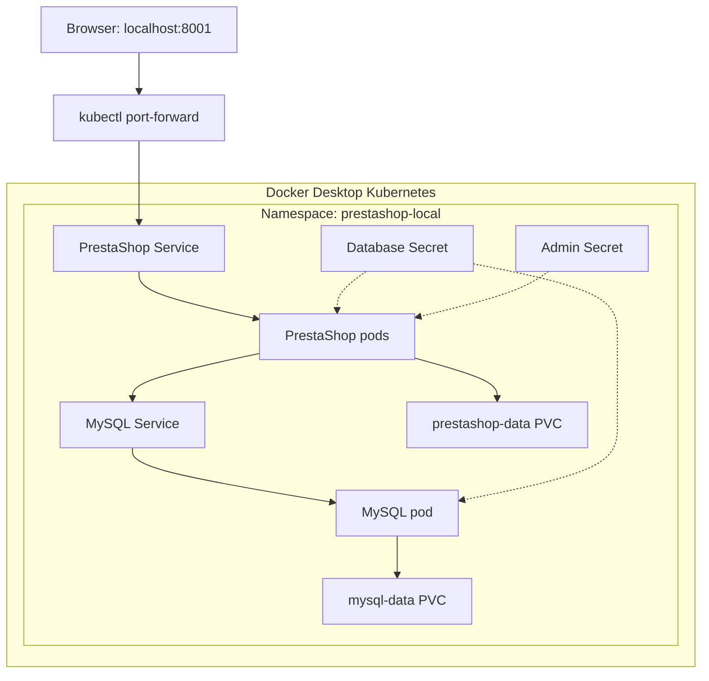

# PrestaShop on Kubernetes: Local Helm Lab

> **Status:** Local deployment, pod-restart tests, a scale-out to two ready application pods and a basic cross-pod browser check completed. Load balancing, concurrency, CI/CD, GitOps and AKS are not yet validated. This is a learning environment, not a production-ready store.

## Project overview

This project deploys an open-source e-commerce application and a MySQL database on Docker Desktop Kubernetes. It focuses on the infrastructure and operational practices needed to run the application: Kubernetes workloads and Services, Helm releases, Secrets, persistent storage, testing and the path to Azure Kubernetes Service (AKS).

The business scenario is an online store that must keep its product catalogue and images available when application or database containers restart. The lab uses sample data and a single local cluster to learn and document these behaviours before designing a production environment.

### What has been demonstrated

- Deployed PrestaShop and MySQL as separate Helm releases in the `prestashop-local` namespace.
- Connected the application to MySQL through an internal Kubernetes Service.
- Created separate persistent volume claims (PVCs) for the database and PrestaShop files.
- Referenced Kubernetes Secrets rather than putting database and admin passwords in the charts.
- Verified a new database was populated by the PrestaShop installer; the observed installation had 301 tables.
- Confirmed a sample product and its uploaded image remained accessible after restarting the PrestaShop Deployment and then the MySQL Deployment.
- Disabled automatic application installation after initial setup and confirmed the store remained usable after a Helm upgrade.
- Scaled the application to two ready pods on the Docker Desktop node; the Service listed both pod IPs as endpoints. Broader concurrency and transaction behaviour remains to be tested.
- Manually forwarded to each pod in turn using the same local browser address; the user reported that the admin session, sample product and image worked after the switch.

The table count is an observation from this installation, not a universal correctness check. Pod restart testing demonstrates persistence in this local cluster; it does not demonstrate a backup, a disaster recovery procedure, or high availability.

## Local architecture



The lab runs on **one local node**. Its initial baseline used one application replica; during the verified scaling experiment the Helm release was changed to two replicas, while MySQL remained at one. A later change to three replicas was reported, followed by a request to return to one; the final applied replica count has not yet been verified in this documentation. `kubectl port-forward` selects a pod through the Service for local browser access; it is not an ingress controller or a load-balancing test.

| Component | Lab configuration and observed history | Purpose |
| --- | --- | --- |
| Kubernetes | Docker Desktop, local single node | Runs workloads without creating Azure resources |
| Application | `prestashop/prestashop:9.1.5-apache`, initially one replica, scaled to two for testing | Storefront and administration |
| Database | `mysql:8.4`, one replica | Stores application data |
| Networking | Internal `ClusterIP` Services | Provides service discovery inside the namespace |
| Database storage | `mysql-data`, 5 GiB, `standard` | Stores MySQL data across pod replacements |
| Application storage | `prestashop-data`, 5 GiB, `standard` | Persists the local application's web directory |
| Secrets | `mysql-credentials`, `prestashop-admin` | Supplies credentials separately from chart values |
| Local access | `localhost:8001` via port-forward | Browser access to the store |

MySQL 8.4.13 was observed in the tested environment, but the configured `mysql:8.4` tag can resolve to another patch release in future. Versioned tags can also be republished; review and pin image digests when stronger reproducibility is needed.

## Repository structure

```text
infrastructure/
└── localdeploy/
    ├── mysql/
    │   ├── Chart.yaml
    │   ├── values.yaml
    │   └── templates/
    │       ├── deployment.yml
    │       ├── pvc.yml
    │       └── service.yml
    └── prestashop/
        ├── Chart.yaml
        ├── values.yaml
        └── templates/
            ├── deployment.yaml
            ├── pvc.yaml
            ├── service.yaml
            └── ...
```

The PrestaShop chart started from `helm create` and includes optional starter templates. Inspect enabled resources before deploying. The MySQL chart is specific to this local lab. Resource names such as `mysql` and the PVC names are fixed in the current templates; installing a second copy in the same namespace can cause naming conflicts.

## Prerequisites

- Docker Desktop with Kubernetes enabled and a Ready node.
- `kubectl`, Helm and Python 3 on the host.
- The repository checked out on the branch containing both Helm charts.
- Enough local disk and memory for the Kubernetes node, MySQL, PrestaShop and their images.
- Port `8001` available on the host, or a coordinated change to the application domain and port-forward command.

Run from the repository root:

```bash
kubectl config get-contexts
kubectl --context docker-desktop get nodes
kubectl --context docker-desktop get storageclass
helm version
```

These instructions target the `docker-desktop` Kubernetes context. Confirm the context before applying any command. Do not use real customer or payment data in this lab.

## Fresh local deployment

> These instructions describe a **new, empty lab**. They do not restore a previous store. Automatic initialization must not be pointed at an existing database as a reset procedure. Back up and verify any data that matters before changing releases, PVCs or the cluster.

### 1. Validate the charts

```bash
helm lint infrastructure/localdeploy/mysql
helm lint infrastructure/localdeploy/prestashop

helm template mysql-local infrastructure/localdeploy/mysql \
  --namespace prestashop-local

helm template prestashop-local infrastructure/localdeploy/prestashop \
  --namespace prestashop-local
```

Review the rendered manifests: MySQL should reference `mysql-credentials`, and PrestaShop should reference that Secret and `prestashop-admin`. Rendering and linting do not create resources and do not prove that the application works.

### 2. Create the namespace

If it does not already exist:

```bash
kubectl --context docker-desktop create namespace prestashop-local
```

### 3. Create local Secrets

The charts expect the following Secrets in `prestashop-local`:

| Secret | Keys | Used by |
| --- | --- | --- |
| `mysql-credentials` | `password`, `root-password` | MySQL initialization and the PrestaShop database connection |
| `prestashop-admin` | `password` | Initial PrestaShop administrator creation |

The following creates them on an **empty lab**. It generates separate MySQL passwords and prompts for an administrator password without echoing it. Save the administrator password securely; do not put it in Git. The script uses `create` and will fail instead of replacing an existing Secret. If one creation succeeds and the other fails, inspect the existing Secret names before retrying.

```bash
python3 - <<'PY'
import getpass
import json
import secrets
import subprocess
import sys

password = getpass.getpass('Choose an admin password: ')
confirmation = getpass.getpass('Confirm admin password: ')
if password != confirmation or len(password) < 12:
    sys.exit('Passwords must match and have at least 12 characters.')

def create_secret(name, values):
    secret = {
        'apiVersion': 'v1', 'kind': 'Secret',
        'metadata': {'name': name, 'namespace': 'prestashop-local'},
        'type': 'Opaque', 'stringData': values,
    }
    subprocess.run(
        ['kubectl', '--context', 'docker-desktop', 'create', '-f', '-'],
        input=json.dumps(secret), text=True, check=True,
    )

create_secret('mysql-credentials', {
    'password': secrets.token_urlsafe(32),
    'root-password': secrets.token_urlsafe(32),
})
create_secret('prestashop-admin', {'password': password})
PY
```

```bash
kubectl --context docker-desktop get secrets -n prestashop-local
```

The Secret references do not make a production secret-management system. Access to Kubernetes Secrets must be controlled, and base64 encoding does not encrypt them. Password changes in an existing Secret do not automatically update an initialized MySQL user or PrestaShop administrator.

### 4. Install MySQL

```bash
helm install mysql-local infrastructure/localdeploy/mysql \
  --namespace prestashop-local --kube-context docker-desktop

kubectl --context docker-desktop rollout status deployment/mysql \
  -n prestashop-local --timeout=5m

kubectl --context docker-desktop get pods,svc,pvc -n prestashop-local
```

Expected: MySQL is ready, its Service exposes `3306/TCP`, and `mysql-data` is `Bound`. MySQL initializes its database and user when its data directory is empty. Reusing an existing PVC does not reinitialize credentials from updated environment variables.

### 5. Bootstrap PrestaShop once

For a **new empty database and application volume**, use an explicit install override:

```bash
helm install prestashop-local infrastructure/localdeploy/prestashop \
  --namespace prestashop-local --kube-context docker-desktop \
  --set-string prestashop.installAuto=1

kubectl --context docker-desktop rollout status deployment/prestashop-local \
  -n prestashop-local --timeout=15m
```

The selected hostname is `localhost:8001`; the lab admin email is configured in the chart. Review both values before installing. The initial installer may take several minutes. Investigate an interrupted or failed initialization before retrying; do not delete PVCs or a partially initialized database as an automatic recovery step.

Once installation and login are confirmed, disable automatic installation for the existing store:

```bash
helm upgrade prestashop-local infrastructure/localdeploy/prestashop \
  --namespace prestashop-local --kube-context docker-desktop \
  --set-string prestashop.installAuto=0 \
  --wait --timeout 10m
```

`installAuto=0` skips automatic installation. It does not delete data or independently disable all possible web installer access. The chart's normal value is `0`; enabling initialization is a deliberate first-install action.

### 6. Open the store

```bash
kubectl --context docker-desktop port-forward \
  -n prestashop-local service/prestashop-local 8001:80
```

Keep the terminal open and visit <http://localhost:8001>. If the pod is replaced, the port-forward may end and need to be restarted. The admin directory may be generated during installation. To find it without printing credentials:

```bash
kubectl --context docker-desktop exec -n prestashop-local \
  deployment/prestashop-local -- \
  find /var/www/html -maxdepth 1 -type d -name 'admin*' \
  -exec basename {} \;
```

Use the actual admin directory, not `admin-api`. Sign in with the configured admin email and the password chosen during Secret creation.

## Operational testing

### Test 1: resources and storage

```bash
kubectl --context docker-desktop get pods,svc,pvc -n prestashop-local
helm list --kube-context docker-desktop -n prestashop-local
```

Expected: both Deployments have ready pods; the MySQL and PrestaShop Services exist; both PVCs are `Bound`. Resource readiness alone does not establish successful checkout or end-to-end correctness.

### Test 2: database initialization and authentication

Run from the MySQL pod through the internal Service:

```bash
kubectl --context docker-desktop exec -n prestashop-local deployment/mysql -- \
  sh -c 'MYSQL_PWD="$MYSQL_PASSWORD" exec mysql --protocol=TCP \
    --host=mysql --user="$MYSQL_USER" "$MYSQL_DATABASE" \
    -e "SELECT DATABASE() AS database_name, CURRENT_USER() AS authenticated_user, VERSION() AS mysql_version; SELECT COUNT(*) AS table_count FROM information_schema.tables WHERE table_schema = DATABASE();"'
```

Expected: the configured database and application user can connect. Before first setup the table count should be zero; after successful setup it should be greater than zero. Do not share credentials or paste full container environment output.

### Test 3: product and file persistence

1. Create a sample product with a price and a test image in the admin panel.
2. Save it and confirm it can be reopened.
3. Restart the PrestaShop Deployment and wait for it to become ready:

```bash
kubectl --context docker-desktop rollout restart deployment/prestashop-local \
  -n prestashop-local
kubectl --context docker-desktop rollout status deployment/prestashop-local \
  -n prestashop-local --timeout=5m
```

4. Restart port-forwarding if necessary, then verify the product and image again.
5. Repeat with the database Deployment, allowing for a temporary application interruption:

```bash
kubectl --context docker-desktop rollout restart deployment/mysql \
  -n prestashop-local
kubectl --context docker-desktop rollout status deployment/mysql \
  -n prestashop-local --timeout=5m
```

6. Refresh the store and confirm the product details and image remain available.

**Observed:** the sample product and image survived both restarts. This verifies the tested restart scenario only; a backup-and-restore test remains outstanding.

## Scaling: local experiment

**Observed:** a Helm upgrade from one to two application replicas rolled out successfully. Both pods reported `1/1 Running` on `desktop-control-plane`, and the PrestaShop Service listed two pod endpoints. When forwarding directly to each pod in turn using the same browser and `localhost:8001`, the user reported that the admin session, sample product and image worked after the switch. Both replicas use the same local node; this basic check does not establish how sessions are stored or validate concurrent traffic, load balancing, node failover or production readiness.

The chart uses a `Recreate` rollout strategy. Increasing `replicaCount` changes the number of application pods, not the number of databases. Scaling MySQL by simply increasing its replicas is not a safe database replication design. The verified two-replica change was a Helm release override; at that point the chart values file was not edited. A later change to three was reported without a recorded deployment or verification output. The desired follow-up is to set one replica in the values file; confirm its applied result rather than assuming it succeeded.

The current `prestashop-data` PVC is `ReadWriteOnce`. That means read/write attachment is restricted to one **node**, not necessarily one pod. Multiple pods on the same Docker Desktop node may mount it, but shared access does not prove the application is safe under concurrent use or across multiple nodes. The current full web-directory mount, application sessions, cache, uploads, installation, upgrades and file locking all need review. One local node also remains a single point of failure.

For a controlled local experiment, use only disposable data and wait until the existing store is fully installed. Keep automatic installation disabled. Confirm the namespace and context before making changes. Multiple application processes will access the same local web-directory volume, so test only after accepting that this is an experiment, not a supported multi-node production design.

1. Record the baseline:

```bash
kubectl --context docker-desktop get deploy,pods,pvc -n prestashop-local
kubectl --context docker-desktop describe service prestashop-local -n prestashop-local
```

2. Verify `PS_INSTALL_AUTO` is `0` in the running application, then use Helm to request two replicas. The `--reuse-values` flag preserves the existing release settings while overriding the replica count. This changes the local release; it does not change the values file in Git:

```bash
helm upgrade prestashop-local infrastructure/localdeploy/prestashop \
  --namespace prestashop-local --kube-context docker-desktop \
  --reuse-values --set replicaCount=2

kubectl --context docker-desktop rollout status deployment/prestashop-local \
  -n prestashop-local --timeout=10m

kubectl --context docker-desktop get pods -n prestashop-local \
  -l app.kubernetes.io/instance=prestashop-local

kubectl --context docker-desktop describe service prestashop-local \
  -n prestashop-local
```

3. Record whether both pods become ready and whether the Service reports two endpoints. Exercise sample login, catalogue, cart and file operations. Inspect failures before proceeding; do not treat two ready pods as proof of safe concurrent use. Kubernetes port-forward to a Service selects a pod and by itself does not demonstrate traffic balancing across both pods or cross-pod session behaviour.

4. Return the local release to one replica using the values-file procedure below. Check the store and sample data again. Command-line overrides are an exploratory local change, not a GitOps workflow. For a lasting desired replica count, review and commit the appropriate values file and deploy it through the chosen workflow.

### Managing the replica count in a file

To return to one application replica, set `replicaCount: 1` in `infrastructure/localdeploy/prestashop/values.yaml`, then render and review the chart before upgrading. This file-based return to one replica is **not yet verified in the recorded results**. Check prior release overrides locally with `helm get values prestashop-local -n prestashop-local --kube-context docker-desktop`; do not share any secrets that might be present. Confirm the file contains all settings that should be retained, including `prestashop.installAuto: "0"`, the database Secret references and local domain. The `--reset-values` option deliberately discards previously stored release overrides, so migrate any required overrides into the file first.

```bash
helm lint infrastructure/localdeploy/prestashop
helm template prestashop-local infrastructure/localdeploy/prestashop \
  --namespace prestashop-local \
  -f infrastructure/localdeploy/prestashop/values.yaml

helm upgrade prestashop-local infrastructure/localdeploy/prestashop \
  --namespace prestashop-local --kube-context docker-desktop \
  --reset-values -f infrastructure/localdeploy/prestashop/values.yaml
```

After the upgrade, verify the deployment has one ready application replica and recheck the store and test product:

```bash
kubectl --context docker-desktop rollout status deployment/prestashop-local \
  -n prestashop-local --timeout=10m
kubectl --context docker-desktop get deployment,pods,pvc -n prestashop-local
```

Commit the reviewed values file to record the intended setting; this is not GitOps until a controller actually reconciles the committed configuration. If port-forwarding was attached to a removed pod, restart it. Scaling the workload is separate from deleting its PVC; do not delete the claims as part of this test.

Before calling a scaled design production-ready, assess shared or externalized files, sessions and caching; coordinate schema upgrades and initialization; use supported multi-node storage; test failures and recovery; and establish load, latency, availability and security requirements. HPA additionally requires appropriate resource requests and working metrics; it is not currently demonstrated.

## Known limitations and recovery considerations

- Kubernetes, database and application each currently have a single local failure domain.
- The `standard` storage class shown in this lab has a `Delete` reclaim policy. Deleting PVCs can delete their underlying data. Helm uninstall, namespace deletion or cluster reset can therefore cause data loss; inspect the actual deletion plan and protect data first.
- Database files and application files both matter for a complete recovery. PVC persistence is not a backup; automated backups and isolated restore testing are future work.
- MySQL runs in the cluster for learning. A future Azure design can evaluate Azure Database for MySQL Flexible Server with private connectivity, TLS, backups and measured sizing.
- TLS, public ingress, observability, security hardening, payment sandbox integration and production performance testing have not been demonstrated here.
- Changing a Git value does not change the cluster until a Helm upgrade or a GitOps controller applies it. Helm itself is not an always-running reconciliation controller.
- An application image update must be tested with the persisted web directory; a mount can retain old application files and affect upgrades.

## Roadmap

1. Document and automate a repeatable fresh-install and safe recovery workflow; verify it in an isolated environment.
2. Extend cross-pod testing to concurrency, failure and recovery, and document the local replica experiment's limitations.
3. Add GitHub Actions to lint and render Helm charts on changes. Build an image only when a custom image is actually required; add image scanning and review as appropriate.
4. Introduce Argo CD to reconcile approved Helm configuration from Git to a non-production cluster.
5. Design AKS networking, managed MySQL, storage, ingress, identity and monitoring with Terraform/HCP Terraform; estimate costs before deployment.
6. Test backup/restore, security, application behaviour and scaling before any production use.

## References

- [PrestaShop project](https://github.com/PrestaShop/PrestaShop)
- [PrestaShop Docker image](https://hub.docker.com/r/prestashop/prestashop)
- [Helm documentation](https://helm.sh/docs/)
- [Kubernetes persistent volumes](https://kubernetes.io/docs/concepts/storage/persistent-volumes/)
- [Kubernetes port forwarding](https://kubernetes.io/docs/reference/kubectl/generated/kubectl_port-forward/)
